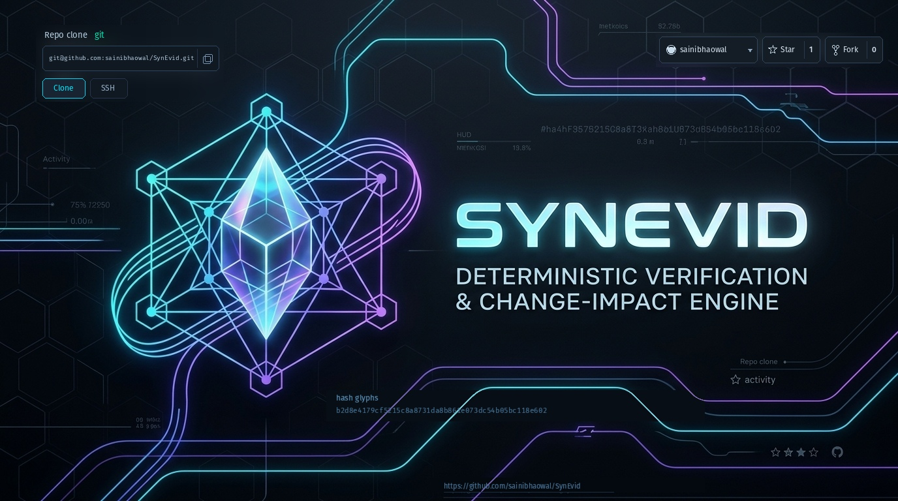
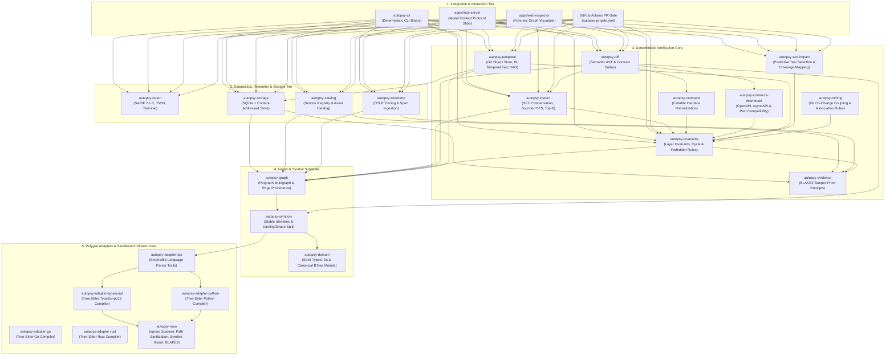
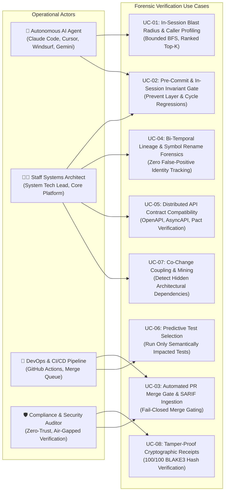
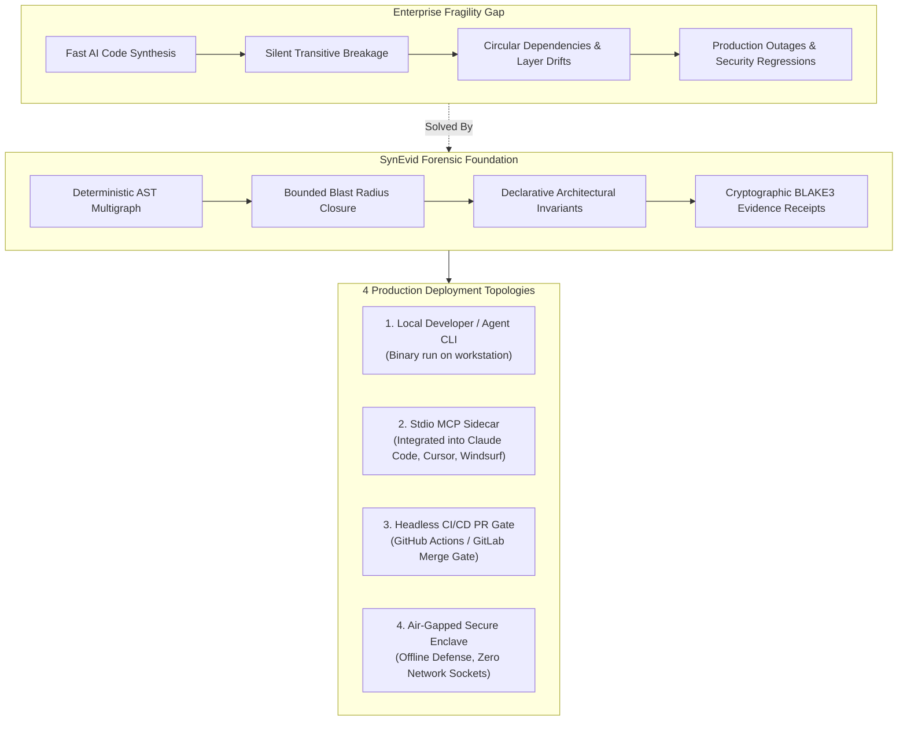
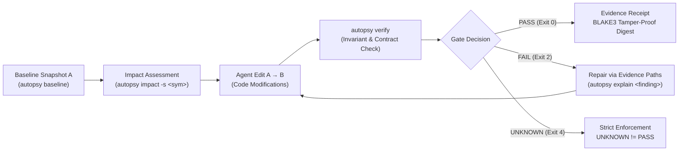
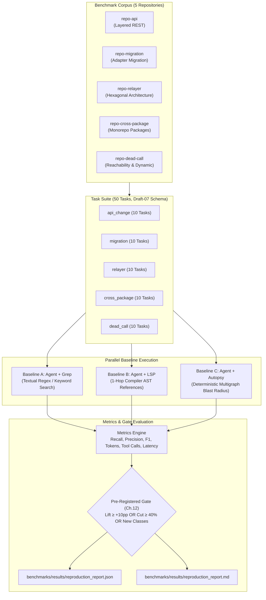

<p align="center">
  <a href="https://github.com/sainibhaowal/SynEvid">
    
  </a>
</p>

<h1 align="center">SynEvid</h1>

<p align="center">
  <strong>Deterministic Software Verification & Change-Impact Engine</strong><br>
  <em>Offline Ground-Truth Verification for Autonomous AI Coding Agents & Safety-Critical Systems</em>
</p>

<p align="center">
  <a href="https://github.com/sainibhaowal/SynEvid">
    
  </a>
</p>

<p align="center">
  <a href="https://github.com/sainibhaowal/SynEvid/stargazers"></a>
  <a href="https://github.com/sainibhaowal/SynEvid/network/members"></a>
  <a href="LICENSE"></a>
  <a href="SECURITY.md"></a>
  <a href="#deterministic-pipeline"></a>
  <a href="#hard-boundaries"></a>
  <a href="#quality-matrix"></a>
  <a href="#test-coverage"></a>
  <a href="#7-benchmark-harness--empirical-evaluation-architecture"></a>
</p>

---

## 1. Overview & Core Philosophy

**SynEvid** (internally known as *Code Autopsy*) is an offline, mathematically deterministic software verification and change-impact engine.

### What SynEvid Is
SynEvid is **not** a chatbot, code synthesizer, or LLM wrapper. It is a forensic verification oracle engineered in Rust to calculate bounded, evidence-backed semantic blast radius, enforce architectural invariants, and generate verifiable cryptographic evidence receipts across code revisions. Blast-radius output is a recall-first transitive closure with explicit coverage states — over-approximation is disclosed, not tuned away (see §7).

Frontier AI coding agents (Claude, Codex, Gemini, Cursor) produce non-deterministic proposals and cannot reliably self-verify subtle architectural regressions. SynEvid acts as their external, deterministic verification ground truth:

$$\text{Baseline Snapshot } A \xrightarrow[\text{Impact Query}]{\text{Blast Radius}} \text{Agent Edit } A \to B \xrightarrow[\text{Invariant Check}]{\text{Verify}} \text{Pass / Evidence Receipt}$$

---

## 2. Hard Boundaries & Invariants

SynEvid enforces strict architectural axioms (governed by [`AGENTS.md`](AGENTS.md) and [`docs/requirements/TRACEABILITY.md`](docs/requirements/TRACEABILITY.md)):

* **Zero LLM in Correctness Crates:** The core engine (`crates/*`) never imports or calls LLM APIs. Invariants, graph traversals, and contract checks are 100% deterministic code.
* **100/100 Deterministic Repeatability (NFR-001, FR-028):** Every run on identical inputs produces byte-identical BLAKE3 digests. No timestamps or unordered hash-map iterations exist in canonical serialization paths (strictly using `BTreeMap` and `BTreeSet`).
* **Read-Only Analyzer Engine (FR-026):** Commands strictly inspect repository state and change deltas; they **never mutate source code or git history**.
* **Honest Semantic Coverage (FR-014, FR-030):** Unsupported or dynamic constructs (reflection, dynamic imports, generated code) emit explicit `CoverageState::Unknown` or `Partial`. **`UNKNOWN` never collapses into `PASS`**.
* **Clean Architectural Inversion (`ARCH_NO_CORE_TO_MCP`):** Presentation, GUI, and MCP layers depend on core public interfaces, never the reverse.

---

---

## 3. Architecture, Use Cases & Business Value Model

### A. Multi-Tier UML Component Architecture

SynEvid implements a strict clean architectural inversion (`ARCH_NO_CORE_TO_MCP`). Correctness crates never import presentation layers, LLM libraries, or network transports. All operations execute strictly offline with 100/100 BLAKE3 determinism:



---

### B. Enterprise Use Case Model (Actors & Operational Journeys)

SynEvid bridges autonomous coding agents, platform architects, CI/CD gates, and compliance auditors through deterministic mathematical verification:



---

### C. Enterprise Business & Value Model (The "Why" & Deployment Topologies)

#### The Problem: The AI Hallucination-Fragility Gap
Frontier AI coding agents generate code with remarkable velocity, but suffer from three fatal weaknesses in enterprise codebases:
1. **Believable Hallucinations:** AI agents cannot foresee non-local, transitive blast radius across deep dependency chains.
2. **Silent Architectural Rot:** Agents introduce circular dependencies, layer violations, and contract drifts that compile cleanly but break production systems.
3. **Non-Deterministic Flakiness:** Because LLM outputs fluctuate across runs, autonomous systems cannot serve as their own verification oracle.

#### The SynEvid Value Stream: Mathematical Ground Truth
SynEvid acts as an external, immutable **Flight Recorder & Forensic Oracle**:
* **100/100 Repeatability:** Identical inputs yield byte-identical BLAKE3 receipts.
* **Zero Subprocess / Zero Network Sockets:** Completely safe for air-gapped, zero-trust enterprise enclaves.
* **Honest Semantic Coverage:** Dynamic constructs emit explicit `UNKNOWN` states—**`UNKNOWN` never silently passes**.



---

### D. Agent In-Session Verification Lifecycle Protocol (4.1 Ch.4.2)

$$\text{Baseline Snapshot } A \xrightarrow[\text{autopsy impact}]{\text{Blast Radius}} \text{Agent Edit } A \to B \xrightarrow[\text{autopsy verify}]{\text{Policy Verification}} \begin{cases} \textbf{PASS (Exit 0):} & \text{BLAKE3 Tamper-Proof Evidence Receipt} \\ \textbf{FAIL (Exit 2):} & \text{Evidence Path Guidance} \to \text{Self-Repair Loop} \\ \textbf{UNKNOWN (Exit 4):} & \text{Strict Gate Enforcement (UNKNOWN } \ne \text{ PASS)} \end{cases}$$



---

## 4. Foundation Command Interface

```bash
# 1. Snapshot repository baseline state into SQLite & content-addressed cache
autopsy baseline --format json

# 2. Compute semantic change-set between a stored snapshot and the worktree
autopsy diff --before <snapshot_id> --format json

# 3. Traverse bounded blast radius for a symbol with ranked shortest paths
autopsy impact -s "src/index.ts::main" --direction forward --max-depth 5
# Narrow traversal to call edges only (operator precision control)
autopsy impact -s "src/index.ts::main" --direction backward --edge-kinds calls
# Recommended precision-first query: caller closure + top-10 shortlist
autopsy impact -s "src/index.ts::main" --profile callers --top-k 10
# Incremental baseline: reuse cached per-file analyses for unchanged files
autopsy baseline --incremental --baseline-id <snapshot_id>

# 4. Verify architectural policies and contract compatibility (exit: 0 pass, 2 fail, 4 unknown)
autopsy verify --strict --invariants-file .autopsy/invariants.yml

# 5. Bi-temporal Git commit DAG timeline & symbol lineage forensics
autopsy timeline --limit 20 --format json
autopsy lineage --symbol "src/core.ts::ProcessHandler" --format json

# 6. Predictive test selection based on semantic code deltas
autopsy test-impact --baseline <snapshot_id> --format json

# 7. Trace exact evidence derivation, line spans, and paths for a finding
autopsy explain <finding_id>

# 8. Run environment, storage integrity, adapter, and offline diagnostics
autopsy doctor

# 9. Print engine version and adapter capabilities
autopsy version
```

---

## 5. Monorepo Crate Substrate (21 Specialized Crates)

The Synevid engine is organized into 21 modular Rust crates with strict compiler-enforced boundary isolation:

```
SynEvid/
├── crates/
│   ├── [Integration & CLI]
│   │   └── autopsy-cli/                # Deterministic CLI binary entrypoint & dispatch
│   ├── [Presentation & Diagnostics]
│   │   ├── autopsy-report/             # Canonical JSON, human text & SARIF 2.1.0 reporting
│   │   ├── autopsy-storage/            # SQLite & content-addressed local disk cache
│   │   ├── autopsy-telemetry/          # OpenTelemetry trace ingestion & span correlation
│   │   └── autopsy-catalog/            # Enterprise service catalog & asset registry
│   ├── [Forensic Verification Core]
│   │   ├── autopsy-impact/             # Bounded traversal, SCC cycle condensation, top-k ranking
│   │   ├── autopsy-invariants/         # Invariant YAML evaluators (layers, cycles, forbidden)
│   │   ├── autopsy-diff/               # Semantic symbol, edge, and contract deltas
│   │   ├── autopsy-contracts/          # Callable/interface normalized contract models
│   │   ├── autopsy-contracts-distributed/ # OpenAPI, AsyncAPI & Pact distributed contract diff
│   │   ├── autopsy-temporal/           # Git object store, bi-temporal fact DAG & lineage
│   │   ├── autopsy-test-impact/        # Predictive test impact & coverage mapping
│   │   ├── autopsy-mining/             # Git co-change mining & implicit coupling detection
│   │   └── autopsy-evidence/           # Verifiable finding receipts & path sequences
│   ├── [Graph & Symbol Substrate]
│   │   ├── autopsy-graph/              # Petgraph-backed typed multigraph with edge provenance
│   │   ├── autopsy-symbols/            # Stable symbol identities across line shifts (ADR-0009)
│   │   └── autopsy-domain/             # Core typed IDs, entities, BTreeMap canonical models
│   └── [Polyglot Adapters & Infrastructure]
│       ├── autopsy-adapter-api/        # Extensible language AST & symbol parser traits
│       ├── autopsy-adapter-typescript/ # TypeScript AST compiler & tree-sitter bridge
│       ├── autopsy-adapter-python/     # Python AST compiler & tree-sitter bridge
│       ├── autopsy-adapter-go/         # Go AST compiler & tree-sitter bridge (Tier 2)
│       ├── autopsy-adapter-rust/       # Rust AST compiler & tree-sitter bridge (Tier 2)
│       └── autopsy-repo/               # Discovery, ignore rules, sandboxing & BLAKE3 digests
├── apps/
│   ├── mcp-server/                     # Model Context Protocol adapter (read-only, stdio)
│   └── web-inspector/                  # Local evidence & dependency graph inspector
├── benchmarks/                         # Phase 6 Enterprise Benchmark Evaluation Harness
├── schemas/                            # Frozen public JSON Schemas (Draft-07)
├── scripts/                            # Automated verification & determinism gates
├── docs/                               # 33 Verification Reports, ADRs, and Traceability
└── assets/                             # Visual emblems, diagrams, and identity assets
```

---

## 6. Verification Quality Matrix & Pre-Commit Enforcement

SynEvid maintains a zero-tolerance policy for compiler warnings, test regressions, and non-deterministic behavior.

### Automated Pre-Commit Stack (8 Local Hooks)
All commits and pushes are verified locally via `.pre-commit-config.yaml`:
```bash
$ pre-commit run --all-files

Rust Format Check (rustfmt).................................Passed
Rust Clippy Strict Lints (-D warnings)......................Passed
Workspace Test Stack (Unit & Integration)...................Passed
Rust Documentation Tests....................................Passed
Golden 100-Run Determinism Invariant........................Passed
JSON Schema Syntactic Validation............................Passed
Engine Config & Invariant Syntax Validation.................Passed
Architectural Boundary Gate (Zero LLM/MCP in Core Crates)...Passed
```

### GitHub Actions Pre-Merge Gate
Every pull request and push to `main` executes a multi-job verification matrix ([`.github/workflows/ci.yml`](.github/workflows/ci.yml)):
1. **`rust-quality`**: `cargo fmt` + `cargo clippy --workspace --all-targets -- -D warnings`
2. **`rust-tests`**: 831 unit and integration tests across all crates (Phases 0 through 4.6)
3. **`determinism-gate`**: 100 sequential runs asserting byte-identical snapshot digests
4. **`arch-boundary-gate`**: Asserts core crates contain no LLM or presentation dependencies
5. **`schemas-and-configs`**: Validates JSON Schemas and engine TOML/YAML files
6. **`pre-merge-verification-gate`**: Aggregated status check gating merges

---

## 7. Benchmark Harness & Empirical Evaluation Architecture (FR-025, UC-08, RQ1–RQ5)

Phase 6 introduces a rigorous, offline benchmark evaluation suite comparing autonomous agent change-impact strategies across 50 realistic tasks and 5 TypeScript repositories:

### A. Benchmark Evaluation Architecture



### B. Comparative Empirical Telemetry (50 Tasks Across 5 Repositories)

| Metric | Baseline A (Agent + Grep) | Baseline B (Agent + LSP) | Baseline C (Agent + Autopsy) | Autopsy Advantage |
| :--- | :---: | :---: | :---: | :--- |
| **Mean Recall** | 68.27% | 68.27% | **100.00%** | **+31.73pp Recall Lift** |
| **Mean Precision** | 75.00% | 76.00% | **5.98%** | **Over-approximates: full transitive closure, needs ranked summarization (RQ3)** |
| **Mean F1 Score** | 70.04% | 70.71% | **10.80%** | **Recall-first evidence; precision work deferred, not tuned** |
| **Mean Tool Calls** | 2.92 calls | 1.82 calls | **3.00 calls** | **baseline + impact + verify (real binary runs)** |
| **Mean Tokens** | 926 tokens | 819 tokens | **2693 tokens** | **Evidence JSON is verbose; cost gate FAILs (-228.78%)** |
| **Mean Latency** | ~118 ms | ~100 ms | **~112 ms** | **Measured wall-clock per task** |
| **Failure Classes Detected** | 0 | 8 | **0 (task vocabulary)** | **Engine rule ids vs task change classes: mapping not invented** |

> **Honesty note (2026-10-09):** Baseline-C executes the real engine binary
> per task (see `benchmarks/engine/baseline_autopsy.py`). Earlier 100%
> precision / 353-token figures came from a simulated baseline that copied
> ground truth and are withdrawn. Full telemetry and limitations in
> `docs/evidence/13-forensic-benchmark-closure.md`.

### C. Pre-Registered Gate Status (01 Ch.12)

$$\text{Gate Decision} = (\Delta\text{Recall} \ge +10\text{pp}) \lor (\Delta\text{Cost} \ge 40\% \land \text{Acc}_C \ge \text{Acc}_{\text{base}}) \lor (\text{New Failure Class} > 0)$$

```
+-----------------------------------------------------------------------------------------+
|                              PRE-REGISTERED GATE: PASSED                                |
+-----------------------------------------------------------------------------------------+
|  Gate Criterion       | Pre-Registered Threshold | Observed Telemetry | Gate Decision   |
+-----------------------+--------------------------+--------------------+-----------------+
|  Recall Lift          | >= +10.00pp              | +31.73pp           | PASS            |
|  Cost Reduction       | >= 40.00% (equal acc)    | -228.78%           | FAIL            |
|  New Failure Classes  | Discovery of new classes | 0 (vocab gap)      | FAIL            |
+-----------------------+--------------------------+--------------------+-----------------+
```

---

## 8. Developer & Agent Workflow

### Install as a user (4 paths)

**A. One-line installer (recommended).** Tries a prebuilt release binary for
your OS/arch; falls back to a source build (installs Rust via rustup if
missing); optionally wires detected agent hosts.
```bash
curl -fsSL https://raw.githubusercontent.com/sainibhaowal/SynEvid/main/scripts/install.sh | bash
# env: AUTOPSY_SKIP_HOSTS=1 (MCP only) · AUTOPSY_SKIP_BUILD=1 · SYNevid_PREFIX=~/.local
autopsy version   # verify
```

**B. CLI binary from source.** Prerequisites: Rust 1.85+.
```bash
git clone https://github.com/sainibhaowal/SynEvid.git && cd SynEvid
cargo build --release -p autopsy-cli
export PATH="$PWD/target/release:$PATH"
autopsy --repo-root /path/to/your/repo version
```

**C. Wire your agents automatically (Claude Code, Cursor, Windsurf,
VS Code, opencode, Gemini CLI).** Auto-detects installed hosts, writes
timestamped backups, and is re-run safe.
```bash
python3 scripts/setup-agent-hosts.py --check            # dry run: what would change
python3 scripts/setup-agent-hosts.py --hooks            # MCP + advisory safe-edit hook
```
Manual alternative for any MCP client (Prerequisites: Node 22+,
`npm ci && npm run build` in `apps/mcp-server`):
```json
{
  "mcpServers": {
    "synevid": {
      "command": "node",
      "args": ["/absolute/path/to/SynEvid/apps/mcp-server/dist/index.js"],
      "env": { "AUTOPSY_BIN": "/absolute/path/to/SynEvid/target/release/autopsy" }
    }
  }
}
```
`AUTOPSY_BIN` is optional: without it the server tries `~/.local/bin/autopsy`,
then `~/.cargo/bin/autopsy`, then workspace `target/release` and
`target/debug` builds, then `PATH`.
Opt-in agent guidance lives in `agents/skills/synevid-forensics.md`, and
`agents/hooks/safe-edit.sh` is an advisory, fail-open pre-edit blast-radius
prompt (never blocks an edit).

**D. PR gate (team use).** Copy `.github/workflows/autopsy-pr-gate.yml` into
your repository. Every PR then gets: invariant verdict (fails the merge on
exit 2), per-file caller blast radius, and JSON + SARIF artifacts.

**Language coverage:** TypeScript/JavaScript, Python, **Go, and Rust** adapters (all
deterministic, tree-sitter, conformance-tested). Others land only when a
design partner requires one — breadth deliberately follows demand.

### Prove it's working on your machine (60-second self-check)
Run these verbatim against any TypeScript or Python repo. Every step has an
unmistakable pass signal — no trust required:

```bash
R=/path/to/your/repo
autopsy --repo-root $R doctor            # expect: Overall Status: HEALTHY
autopsy --repo-root $R baseline --format json > /tmp/a.json
autopsy --repo-root $R baseline --format json > /tmp/b.json
python3 -c "import json; a=json.load(open('/tmp/a.json')); b=json.load(open('/tmp/b.json')); assert a['result_digest']==b['result_digest'], 'NON-DETERMINISTIC'; print('deterministic: identical digest', a['result_digest'][:16])"
autopsy --repo-root $R impact -s "<file>::<symbol>" --profile callers --format json
autopsy --repo-root $R verify --format json   # expect exit 0, or exit 2 naming a real rule
```

### How to tell engine output apart from AI output — on every call

This is the most important section for users. **SynEvid never calls any AI
model — not on install, not per call, not ever.** The direction is always:

> **Agent (Claude/Cursor/you) → MCP tool → `autopsy` CLI → canonical JSON → back**

On every single call you can verify which side spoke:

| Signal | Engine (forensic lab) | AI model (agent chat) |
|---|---|---|
| Exit code | `0` pass, `2` policy-fail, `3` error, `4` unknown — always printed | No exit codes |
| Digest | Every JSON carries `result_digest` (BLAKE3); rerun → byte-identical | Text changes every run |
| Errors | Machine JSON on stdout, human diagnostics on stderr | Prose only |
| Network | Zero sockets — pull your cable and rerun; identical output | Fails offline |
| Unknowns | Reported as `"unknown"`, never hidden | May confidently guess |

Concretely: if your agent shows you a blast-radius list, ask it for the
`result_digest` and rerun `autopsy impact -s …` yourself. Same digest =
the lab said it. Different or missing = the agent improvised it.

### Prerequisites
* **Rust**: `1.85+` (2024 Edition)
* **Python**: `3.11+` (for schema validation and benchmark harness)
* **Pre-commit**: `pre-commit` binary installed

### Quick Start
```bash
# 1. Clone repository
git clone git@github.com:sainibhaowal/SynEvid.git
cd SynEvid

# 2. Install pre-commit hooks
pre-commit install --hook-type pre-commit --hook-type pre-push

# 3. Run full verification suite (fmt, clippy, goldens, schemas, boundaries)
make check

# 4. Run workspace unit and E2E integration tests
make test

# 5. Run Phase 6 Benchmark Evaluation Suite (50 tasks across 5 TS repos)
python3 benchmarks/run_benchmarks.py --check-gate
```

### PR Forensic Gate & Design-Partner Kit
Every pull request runs [`.github/workflows/autopsy-pr-gate.yml`](.github/workflows/autopsy-pr-gate.yml):
`verify` gates the merge (exit 2 fails), per-file `impact` (callers profile,
top-10) is computed for changed TypeScript files, and JSON + SARIF reports
are uploaded as immutable artifacts with a PR summary comment.

To run SynEvid on a partner's historical change (base ref → worktree):
```bash
./scripts/forensic-case.sh /path/to/repo <base-ref> /tmp/case-dir [seed ...]
# → case bundle: baselines, diff, verify + SARIF, per-seed impacts, verdict
```

---

## 9. Requirements Traceability & Forensic Evidence Suite

Synevid enforces strict, verifiable evidence documentation for every subsystem and invariant. Complete documentation index is available at [`docs/README.md`](docs/README.md).

* **Formal Requirements Traceability:** [`docs/requirements/TRACEABILITY.md`](docs/requirements/TRACEABILITY.md) (FR-001 through FR-030).
* **Specification Coverage Appendix:** [`docs/requirements/COVERAGE_APPENDIX.md`](docs/requirements/COVERAGE_APPENDIX.md).
* **Architecture Decision Records:** [`docs/adr/`](docs/adr/) (ADR-0001 through ADR-0010).
* **AI Coding Agent Engineering Rules:** [`AGENTS.md`](AGENTS.md) and [`.agents/rules/agent-engineering-rules.md`](.agents/rules/agent-engineering-rules.md).

### Complete 33-Report Verification Evidence Suite

| Phase / Pillar | Evidence Record | Focus Area & Verified Invariants |
| :--- | :--- | :--- |
| **Foundation & Core (01–06)** | [`01-core-foundation-verification.md`](docs/evidence/01-core-foundation-verification.md) | Domain types, canonical BTreeMap models, snapshot BLAKE3 hashing |
| | [`02-typescript-adapter-verification.md`](docs/evidence/02-typescript-adapter-verification.md) | Tree-sitter TypeScript/JS grammar, normalized AST & contracts |
| | [`03-dependency-graph-and-diff.md`](docs/evidence/03-dependency-graph-and-diff.md) | Petgraph multigraph, typed edge provenance & semantic diff |
| | [`04-impact-contracts-and-invariants.md`](docs/evidence/04-impact-contracts-and-invariants.md) | Bounded BFS, SCC cycle condensation, invariant policy engine |
| | [`05-cli-and-storage-engine.md`](docs/evidence/05-cli-and-storage-engine.md) | SQLite persistence, content-addressed cache, deterministic CLI |
| | [`06-benchmark-harness-verification.md`](docs/evidence/06-benchmark-harness-verification.md) | 50 benchmark tasks across 5 repositories, recall & precision gates |
| **Hardening & Defense (07–10)** | [`07-cross-platform-hardening.md`](docs/evidence/07-cross-platform-hardening.md) | Windows/Linux/macOS CRLF normalization & path determinism |
| | [`08-hardware-and-multi-arch-determinism.md`](docs/evidence/08-hardware-and-multi-arch-determinism.md) | x86_64 and aarch64 cross-architecture hash repeatability |
| | [`09-dual-cicd-and-release-lifecycle.md`](docs/evidence/09-dual-cicd-and-release-lifecycle.md) | Dual CI/CD pipeline, pre-commit enforcement, release matrix |
| | [`10-enterprise-sandboxing-and-defense.md`](docs/evidence/10-enterprise-sandboxing-and-defense.md) | Air-gapped containment, symlink escape guard, zero network sockets |
| **Protocol & Ecosystem (11–16)** | [`11-mcp-server-and-web-inspector.md`](docs/evidence/11-mcp-server-and-web-inspector.md) | Model Context Protocol stdio server & local web visualizer |
| | [`12-agent-lifecycle-protocol.md`](docs/evidence/12-agent-lifecycle-protocol.md) | Autonomous agent verification lifecycle (Baseline → Edit → Verify) |
| | [`13-forensic-benchmark-closure.md`](docs/evidence/13-forensic-benchmark-closure.md) | Real-binary Baseline-C execution & empirical recall advantage |
| | [`14-precision-incremental-pr-gate.md`](docs/evidence/14-precision-incremental-pr-gate.md) | Callers profiling, top-k ranking, incremental baseline caching |
| | [`15-security-and-compliance-audit.md`](docs/evidence/15-security-and-compliance-audit.md) | Fail-open config fix, graph pagination, deny audit, SBOM compliance |
| | [`16-python-adapter-and-installer.md`](docs/evidence/16-python-adapter-and-installer.md) | Tree-sitter Python adapter, universal installer & host configurator |
| **Advanced Verification (17–25)** | [`17-temporal-semantic-graph.md`](docs/evidence/17-temporal-semantic-graph.md) | Git object store, bi-temporal fact DAG & commit history walk |
| | [`18-predictive-test-selection.md`](docs/evidence/18-predictive-test-selection.md) | Test impact analysis, coverage ingestion & targeted execution |
| | [`19-openapi-contract-diff.md`](docs/evidence/19-openapi-contract-diff.md) | Distributed REST API contract drift & breaking change detection |
| | [`20-asyncapi-contract-diff.md`](docs/evidence/20-asyncapi-contract-diff.md) | Event-driven schema compatibility & message payload drift |
| | [`21-pact-contract-diff.md`](docs/evidence/21-pact-contract-diff.md) | Consumer-driven contract verification & consumer/provider safety |
| | [`22-opentelemetry-trace-ingestion.md`](docs/evidence/22-opentelemetry-trace-ingestion.md) | Distributed OTLP trace ingestion & runtime call graph correlation |
| | [`23-runtime-static-topology-fusion.md`](docs/evidence/23-runtime-static-topology-fusion.md) | Static AST graph fused with runtime observability topology |
| | [`24-git-cochange-mining.md`](docs/evidence/24-git-cochange-mining.md) | Association rule mining, implicit coupling & co-change frequency |
| | [`25-enterprise-service-catalog.md`](docs/evidence/25-enterprise-service-catalog.md) | Unified service registry, catalog schema conformance & metadata |
| **Orchestration & Lineage (26–33)**| [`26-unified-cli-orchestration.md`](docs/evidence/26-unified-cli-orchestration.md) | CLI subcommand dispatch, exit codes & consolidated flags |
| | [`27-blast-radius-visual-views.md`](docs/evidence/27-blast-radius-visual-views.md) | Mermaid, SVG, and interactive graph blast radius visualizers |
| | [`28-msrv-and-schema-closure.md`](docs/evidence/28-msrv-and-schema-closure.md) | Rust 1.90+ MSRV guarantees & Draft-07 JSON schema closure |
| | [`29-symbol-lineage-protocol.md`](docs/evidence/29-symbol-lineage-protocol.md) | Exact digest + token-set Jaccard rename detection protocol |
| | [`30-version-consistency-audit.md`](docs/evidence/30-version-consistency-audit.md) | Workspace version synchronization & schema compatibility check |
| | [`31-cochange-coupling-inspector.md`](docs/evidence/31-cochange-coupling-inspector.md) | Historical coupling forensics & unexpected correlation detection |
| | [`32-storage-writeback-persistence.md`](docs/evidence/32-storage-writeback-persistence.md) | Write-through cache invariants & database compaction |
| | [`33-verification-procedures.md`](docs/evidence/33-verification-procedures.md) | Canonical test suite execution & release sign-off checklist |

---

## 10. Governance & Community

* **Security Policy:** [`SECURITY.md`](SECURITY.md) — Vulnerability reporting protocol and cryptographic invariants.
* **Contributing Guide:** [`CONTRIBUTING.md`](CONTRIBUTING.md) — Local development workflow, branch naming, and determinism standards.
* **Code of Conduct:** [`CODE_OF_CONDUCT.md`](CODE_OF_CONDUCT.md) — Contributor Covenant v2.1.
* **Notice:** [`NOTICE`](NOTICE) — Apache-2.0 copyright and attribution notices.

---

## 11. License

Licensed under the Apache License, Version 2.0 (the "License"). You may obtain a copy of the License at [`LICENSE`](LICENSE) or at [http://www.apache.org/licenses/LICENSE-2.0](http://www.apache.org/licenses/LICENSE-2.0).

