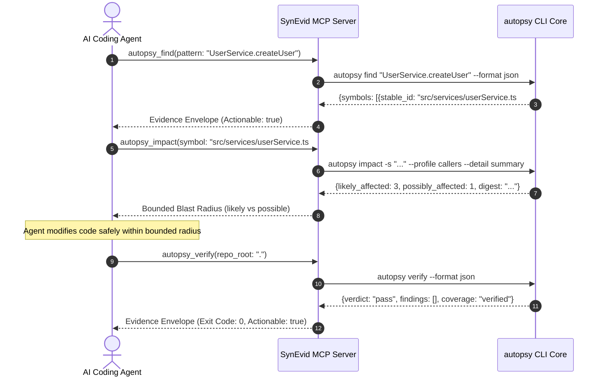

# SynEvid (Code Autopsy) — Universal Integration & Connection Guide

This guide provides end-to-end instructions for connecting, configuring, and utilizing **SynEvid (Code Autopsy)** across all AI agent hosts, MCP clients, IDEs, package managers, and CI/CD pipelines.

---

## 1. Core Architecture & Operating Principles

SynEvid is an offline, mathematically deterministic software verification and change-impact engine. When connected to AI coding agents, it serves as an immutable forensic ground-truth oracle:

$$\text{Baseline Snapshot } A \xrightarrow[\text{autopsy\_find} \to \text{autopsy\_impact}]{\text{Blast Radius}} \text{Agent Edit } A \to B \xrightarrow[\text{autopsy\_verify}]{\text{Verification Gate}} \text{Pass / Enveloped Repair}$$

### Non-Negotiable Invariants
- **Zero LLM in Core:** Core analysis crates (`crates/*`) never import or query LLM APIs. Every verification check is 100% deterministic code.
- **Strictly Read-Only:** SynEvid never modifies source code, branches, or git history.
- **100/100 BLAKE3 Determinism:** Every execution on identical inputs yields byte-identical cryptographic digests.
- **The Evidence Envelope:** Every tool output travels inside `{command, exit_code, actionable, report, repair}`. Raw stack traces and bare JSON errors are prohibited.
- **Air-Gapped & Offline:** Zero outbound network calls and zero sub-process execution in core crates.

---

## 2. Connecting AI Agent Hosts via MCP (Model Context Protocol)

SynEvid provides an official Model Context Protocol (MCP) server speaking newline-delimited JSON-RPC 2.0 over standard input and output (`stdio`).

### Connection Methods Comparison

| Connection Method | When to Use | Command / Invocation |
|---|---|---|
| **Zero-Install (`npx @synevid/mcp`)** | Simplest for local development; no manual clone or build required. | `npx -y @synevid/mcp` |
| **Installed User Binary** | Standard after running the one-line installer (`install.sh` / `install.ps1`). | Node running bundled server or `synevid-mcp` |
| **Automatic Multi-Host Wiring** | One-shot setup across all installed AI tools with automated backups. | `python3 scripts/setup-agent-hosts.py --hooks` |

---

### A. Claude Desktop

**Config File Location:**
- **macOS:** `~/Library/Application Support/Claude/claude_desktop_config.json`
- **Windows:** `%APPDATA%\Claude\claude_desktop_config.json`
- **Linux:** `~/.config/Claude/claude_desktop_config.json`

#### Option 1: Zero-Install (`npx @synevid/mcp`)
```json
{
  "mcpServers": {
    "synevid": {
      "command": "npx",
      "args": ["-y", "@synevid/mcp"],
      "env": {
        "AUTOPSY_BIN": "autopsy"
      }
    }
  }
}
```

#### Option 2: Pre-Installed Binary
```json
{
  "mcpServers": {
    "synevid": {
      "command": "node",
      "args": ["/home/YOUR_USER/.local/share/synevid/mcp-server/index.js"],
      "env": {
        "AUTOPSY_BIN": "/home/YOUR_USER/.local/bin/autopsy"
      }
    }
  }
}
```
*(On Windows, use `C:\\Users\\YOUR_USER\\.local\\bin\\autopsy.exe`)*

---

### B. Claude Code (Anthropic CLI)

Claude Code connects to MCP servers and supports automatic end-of-task verification hooks.

**Configuration:** Add via CLI or edit `~/.claude.json`:
```bash
claude mcp add synevid npx -y @synevid/mcp
```

Or in `~/.claude.json` / `~/.claude/config.json`:
```json
{
  "mcpServers": {
    "synevid": {
      "command": "npx",
      "args": ["-y", "@synevid/mcp"]
    }
  }
}
```

#### Automatic Task-Completion Stop Hook
To automatically run invariant checks and generate a forensic trajectory report whenever Claude Code completes a task:
```bash
# Automatically wires the Claude Code Stop hook
python3 scripts/setup-agent-hosts.py --hooks
```
This registers [`agents/hooks/autopsy-task-complete.sh`](file:///agents/hooks/autopsy-task-complete.sh), ensuring `.autopsy/runs/latest.md` is updated after every task.

---

### C. Cursor IDE

**Config File Location:**
- **Global:** `~/.cursor/mcp.json`
- **Per-Project:** `<your-project-root>/.cursor/mcp.json`

Add the server definition:
```json
{
  "mcpServers": {
    "synevid": {
      "command": "npx",
      "args": ["-y", "@synevid/mcp"],
      "env": {
        "AUTOPSY_BIN": "autopsy"
      }
    }
  }
}
```

In Cursor Chat or Composer, reference SynEvid tools using `@synevid`:
- `@synevid autopsy_find pattern="UserService"`
- `@synevid autopsy_impact symbol="src/services/userService.ts#method:UserService.createUser"`
- `@synevid autopsy_verify`

---

### D. Windsurf IDE (Codeium)

**Config File Location:**
- **Linux/macOS:** `~/.codeium/windsurf/mcp_config.json`
- **Windows:** `%USERPROFILE%\.codeium\windsurf\mcp_config.json`

```json
{
  "mcpServers": {
    "synevid": {
      "command": "npx",
      "args": ["-y", "@synevid/mcp"],
      "env": {
        "AUTOPSY_BIN": "autopsy"
      }
    }
  }
}
```

---

### E. VS Code & Cursor IDE Extension (`synevid-vscode`)

SynEvid includes a dedicated, zero-build IDE extension located in [`apps/vscode-extension/`](file:///apps/vscode-extension/).

#### Key Features:
1. **Inline Blast Radius CodeLens:**
   Directly above methods and classes across TypeScript, JavaScript, Python, Go, and Rust, CodeLens displays live metrics:
   $$\text{\$(pulse) 12 callers · 3 tests}$$
   Clicking the CodeLens runs `autopsy impact` for that symbol.
2. **Semantic Hover Cards:** Hovering over any symbol renders an offline markdown card with caller counts, edge confidence grades, and cryptographic result digests.
3. **Status Bar Indicator:** `$(shield) SynEvid: Ready` in the bottom status bar gives one-click architectural verification.
4. **Task Forensic Trajectory View:** A dedicated Activity Bar panel rendering `.autopsy/runs/latest.json` with step-by-step verdicts and next-agent guidance.

#### Installing into VS Code / Cursor:
```bash
cd apps/vscode-extension
# Package or symlink into extensions folder
mkdir -p ~/.vscode/extensions/synevid-vscode
cp -r . ~/.vscode/extensions/synevid-vscode/
```

#### Settings (`settings.json`):
```json
{
  "synevid.enableCodeLens": true,
  "synevid.autopsyPath": "autopsy",
  "synevid.lspPath": "synevid-lsp"
}
```

---

### F. Automated 1-Command Multi-Host Setup

The included host-setup tool detects installed agent environments, validates configurations, creates timestamped backups, and wires MCP servers and hooks automatically:

```bash
# 1. Preview changes (dry run)
python3 scripts/setup-agent-hosts.py --check

# 2. Wire MCP servers + advisory pre-edit and task-complete hooks
python3 scripts/setup-agent-hosts.py --hooks

# 3. Cleanly unwire and restore original configuration
python3 scripts/setup-agent-hosts.py --unwire
```

Supported hosts: Claude Code, Claude Desktop, Cursor, Windsurf, VS Code, opencode, Gemini CLI.

---

## 3. The 11 MCP Tools & 7 Dynamic Resources

### The 11 Tools (Available in Agent Context)

| Tool Name | Key Parameters | Description |
|---|---|---|
| `autopsy_status` | `repo_root`, `snapshot_id?` | Inspect active languages, snapshot hash, adapter capabilities, and baseline health. |
| `autopsy_find` | `pattern`, `repo_root?`, `limit?` | Fuzzy/exact symbol search resolving human names to deterministic stable IDs. |
| `autopsy_impact` | `symbol`, `profile?`, `detail?` | Computes bounded blast radius. Partitions into `likely_affected` vs `possibly_affected`. |
| `autopsy_diff` | `base`, `head`, `repo_root?` | Computes semantic AST diff between two snapshots without executing code. |
| `autopsy_verify` | `repo_root?`, `base?`, `strict?` | Evaluates architectural layer invariants and contract compatibility rules. |
| `autopsy_explain` | `evidence_id`, `repo_root?` | Generates proof trees and rule derivation steps for any finding receipt. |
| `autopsy_session` | `action`, `step?`, `verdict?` | Manages agent task sessions (`start`, `record`, `close`, `report`, `list`). |
| `autopsy_temporal` | `repo_root?`, `max_commits?` | Bi-temporal facts journal and git co-change coupling analysis. |
| `autopsy_test_selection` | `changed_files`, `repo_root?` | Selects the minimal deterministic set of unit/integration tests to execute. |
| `autopsy_contract_diff` | `contract_a`, `contract_b` | Validates OpenAPI, AsyncAPI, and JSON schema backward compatibility. |
| `autopsy_distributed_blast_radius` | `component`, `repo_root?` | Evaluates cross-service ownership and distributed blast radius. |

---

### The 7 Dynamic MCP Resources

Agents can read these URIs directly to inspect ground truth:

1. **`autopsy://tools`**: Complete, self-describing toolspec in JSON (exit codes, global flags, argument contracts).
2. **`autopsy://runs/latest`**: Latest forensic task report (`.autopsy/runs/latest.json`) with starting/ending snapshots and agent guidance.
3. **`autopsy://graph/map{?under,top,repo_root}`**: High-level structural projection of nodes, packages, and degree hubs.
4. **`autopsy://graph{?repo_root}`**: Overall multigraph node, edge, and density statistics.
5. **`autopsy://graph/symbols{?limit,offset,kind,repo_root}`**: Deterministically paginated symbol directory.
6. **`autopsy://graph/edges{?source,direction,kind,limit}`**: Paginated 1-hop inbound and outbound neighborhood.
7. **`autopsy://workspace{?repo_root}`**: Multi-repository registry for monorepos and distributed systems.

---

### The Recommended 3-Step Agent Loop

Autonomous agents follow this canonical 3-tool sequence:



---

## 4. Universal Package Managers & Distribution

SynEvid supports all primary packaging standards:

### 1. Homebrew (macOS & Linux)
```bash
# Official Tap
brew tap sainibhaowal/synevid https://github.com/sainibhaowal/SynEvid
brew install synevid

# Direct local formula installation
brew install Formula/synevid.rb
```
Installs binaries `autopsy`, `synevid`, `synevid-ui`, and `synevid-lsp`.

### 2. Cargo Binstall (Rust Pre-Compiled Binaries)
```bash
# Instant binary installation without compiling from source
cargo binstall autopsy-cli
```

### 3. Zero-Install MCP (`npx`)
```bash
# Run stdio MCP server directly without install
npx @synevid/mcp
```

### 4. Python & `uvx` Wrapper
```bash
# Install CLI via pip
pip install synevid

# Zero-install run via uvx
uvx synevid doctor
uvx --from synevid autopsy verify
```

### 5. Multi-Arch Docker Container
Prebuilt for `linux/amd64` and `linux/arm64` non-root containers:
```bash
# Verify architectural invariants inside a container
docker run --rm -v "$PWD:/repo" ghcr.io/sainibhaowal/synevid verify

# Run interactive terminal dashboard in Docker
docker run --rm -it -v "$PWD:/repo" ghcr.io/sainibhaowal/synevid tui
```

### 6. Linux Native Packages (`.deb` & `.rpm`)
- **Debian / Ubuntu:** `sudo dpkg -i synevid_0.1.0_amd64.deb`
- **Fedora / RHEL:** `sudo rpm -Uvh synevid-0.1.0-1.x86_64.rpm`

---

## 5. Team Automation & CI/CD Integration

### A. Marketplace GitHub Action (`action.yml`)

Add automated invariant checks and SARIF reporting to GitHub Actions in one step:

```yaml
# .github/workflows/verify.yml
name: Invariant Verification

on:
  pull_request:
    branches: [main]
  push:
    branches: [main]

jobs:
  synevid-gate:
    runs-on: ubuntu-latest
    steps:
      - name: Checkout Code
        uses: actions/checkout@v4

      - name: SynEvid Invariant Verification Gate
        uses: sainibhaowal/synevid-action@v1
        with:
          strict: "true"
          sarif-output: "autopsy.sarif"
          step-summary: "true"

      - name: Upload SARIF to GitHub Code Scanning
        uses: github/codeql-action/upload-sarif@v3
        if: always()
        with:
          sarif_file: autopsy.sarif
```

#### GitHub Actions Summary Telemetry:
Appends a clean verification card directly to `$GITHUB_STEP_SUMMARY`:
- **Verdict:** `PASS` / `FAIL`
- **Snapshot ID:** Deterministic BLAKE3 hash
- **Exit Code:** `0` (pass) or `2` (policy fail)
- **Engine Mode:** Offline, Deterministic (Zero-LLM)

---

### B. Pre-Commit Hook Repository

Enforce offline architectural invariants on developer machines before commits reach git:

```yaml
# .pre-commit-config.yaml
repos:
  - repo: https://github.com/sainibhaowal/synevid
    rev: v0.1.0
    hooks:
      - id: synevid-verify    # Validates invariants and backward compatibility
      - id: synevid-doctor    # Health check for languages and storage
      - id: synevid-baseline  # (Optional post-commit) Records baseline snapshot
```

---

## 6. Real-Time Presentation & Observation Suite

In addition to headless CLI and MCP modes, SynEvid provides three real-time presentation interfaces:

### 1. Embedded Local Web Dashboard (`autopsy ui` / `synevid-ui`)
A zero-npm standalone HTTP server embedded directly in memory:
```bash
autopsy ui --port 3333 --open
```
- Serves an enterprise dark-mode single-page visualizer.
- Endpoints: `/api/status`, `/api/verify`, `/api/impact`, `/api/graph`, `/api/contracts`, `/api/trajectory`.
- Complies strictly with the zero-outbound-network-socket invariant.

### 2. Interactive Terminal Dashboard (`autopsy tui`)
A full-screen, high-contrast Ratatui terminal interface:
```bash
autopsy tui
```
- **Navigation:** Arrow keys and `1`–`5` to switch tabs (`Overview`, `Invariants`, `Blast Radius`, `Trajectory`, `Help`).
- **Interactive Search:** Press `/` to search symbols and view live caller impact tiers.
- **Color Tokens:** Emerald (`#10b981`) for verified, Amber (`#f59e0b`) for inferred/partial, Rose (`#f43f5e`) for breaking changes.

### 3. Real-Time File Watcher (`autopsy watch`)
Monitors the codebase and incrementally re-verifies invariants on save:
```bash
autopsy watch --debounce 200
```
- 200ms debounced event queue.
- Interactive hotkeys: `v` (force verify), `b` (new baseline snapshot), `c` (clear screen), `q` (quit).

---

## 7. Zero-Config Onboarding (`autopsy init`)

Initialize policy and configuration in any repository:
```bash
autopsy init
```

### Heuristic Layer Detection
`autopsy init` deterministically inspects repository structure and automatically configures:
- **Presentation:** `src/{api,controllers,routes,handlers,ui,web,cli}`, root `api/`, `controllers/`, `handlers/`, `apps/`.
- **Application:** `src/{services,usecases,application,app}`, `services/`, `usecases/`, `packages/`.
- **Domain:** `src/{domain,models,entities,core}`, root `domain/`, `models/`, `entities/`, `core/`, `crates/`, `pkg/`.
- **Infrastructure:** `src/{infra,infrastructure,db,repositories,adapters}`, `infra/`, `infrastructure/`, `internal/`.

### Generated Artifacts
1. `autopsy.toml`: Repository file inclusion/exclusion rules and analysis parameters.
2. `.autopsy/invariants.yml`: Unidirectional architecture layer rules (`presentation → application → domain → infrastructure`) plus `NO_NEW_DEPENDENCY_CYCLES` and `PUBLIC_API_CONTRACT_COMPATIBILITY`.
3. `.autopsy/baseline.json`: Baseline debt ledger.

*Existing configurations are safely preserved unless `--force` is passed.*

---

## 8. Verification Self-Check & Troubleshooting

Run this 30-second verification script to verify engine readiness:

```bash
# 1. Check version and installed binaries
autopsy --version
synevid --version

# 2. Verify engine diagnostics and language adapters
autopsy doctor

# 3. Test MCP stdio wire protocol
node -e '
const { spawn } = require("child_process");
const p = spawn("autopsy", ["tools", "--format", "json"]);
let d = "";
p.stdout.on("data", c => d += c);
p.on("close", () => console.log("Tools registered:", JSON.parse(d).tools.length));
'
```

Expected diagnostic output:
```
================================================================================
 CODE AUTOPSY SYSTEM DIAGNOSTIC (DOCTOR)
================================================================================
 [ PASS ] Repository root exists (.)
 [ PASS ] Storage database & cache store operational
 [ PASS ] Adapter operational: TypeScript
 [ PASS ] Adapter operational: Python
 [ PASS ] Adapter operational: Go
 [ PASS ] Adapter operational: Rust
 [ PASS ] Invariants configuration valid: 1 rules loaded
 [ PASS ] Offline verification: zero network calls configured
================================================================================
 Overall Status: HEALTHY
================================================================================
```
