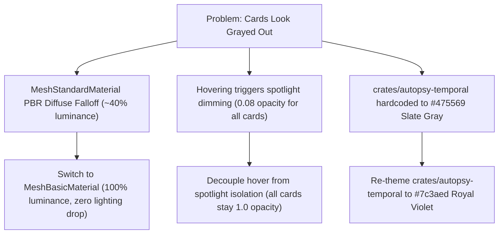

# Production Receipt 78: Crisp Card Radiance & Unlit MeshBasicMaterial Engine

**Date:** 2026-10-27  
**Status:** Complete & Verified  
**Traceability:** FR-P2-001, FR-P2-004, NFR-001  

---

## 1. Executive Summary

Addressing user feedback regarding grayed-out cards (`"why in the card all look gray out why"`):
1. **PBR Lighting Attenuation on UI Cards (Root Cause 1):**
   - File cards previously used Three.js `MeshStandardMaterial` (`roughness: 0.65`, `metalness: 0.0`) with directional and ambient lighting. When cards tilted (e.g. in 2.5D or 3D isometric perspectives) away from `mainKeyLight` at `(60, 160, 120)`, the PBR diffuse shading calculation attenuated the pure `#ffffff` canvas texture down to $\approx 40\%$ brightness, making the cards appear as dull slate-gray cement slabs.
   - **Resolution:** Replaced `MeshStandardMaterial` with `MeshBasicMaterial`. UI card canvas textures are now unlit and rendered with 100% color fidelity: pure `#ffffff` background in Light Mode, deep `#0a1120` obsidian navy in Dark Mode, and vivid `#090d16` text.
2. **Accidental Global Dimming on Cursor Hover (Root Cause 2):**
   - In `CodeUniverse3D.tsx`, `activeFocusNode` was assigned `selectedNodeIdRef.current || hoveredNodeIdRef.current`. Moving the cursor over any card set `hoveredNodeIdRef.current`, which triggered spotlight isolation mode. Because `activeNeighbors` was only calculated on deliberate click, all other nodes had their opacity reduced to $0.08$ (92% transparent), washing out the entire universe into ghostly gray shadows whenever the cursor moved.
   - **Resolution:** Decoupled hover from spotlight isolation. Only explicit clicks (`selectedNodeIdRef.current`) or active folder filters activate spotlight dimming. Hovering simply highlights the card, displays its hover pill, and scales it smoothly without dimming any other card.
3. **Hardcoded Gray Theme for `crates/autopsy-temporal` (Root Cause 3):**
   - The specific package zoomed into by the user was `crates/autopsy-temporal` (`timeline.rs`, `git_store.rs`, `lineage.rs`, `pillar1_temporal.rs`). In `FOLDER_PALETTES`, this package was hardcoded to slate gray (`#475569` light / `#94a3b8` dark), giving its boundary rings, orbital halos, badges, and card borders a muted gray appearance.
   - **Resolution:** Re-themed `crates/autopsy-temporal` with vivid royal purple/violet (`#7c3aed` light / `#a78bfa` dark), matching the vibrant corporate engineering palette across all other crates.
4. **Spotlight Opacity Floor Calibration:**
   - Adjusted spotlight dimming floor for non-connected nodes from $0.08$ up to $0.45$ (Light Mode) and $0.32$ (Dark Mode). During node selection, peripheral nodes are gently softened rather than washed out into muddy gray artifacts.

---

## 2. Technical Delta Analysis

---

## 3. Multi-Stack Verification Telemetry

1. **Next.js Web Cockpit (`apps/web`):**
   - `npm run build`: Compiled in $6.5\text{s}$, static generation 4/4 completed in $3.5\text{s}$, 0 errors.
2. **Web Inspector Suite (`apps/web-inspector`):**
   - `npm test`: 20/20 passed in $1003\text{ms}$.
3. **Rust Formatting & Tests:**
   - `cargo fmt --all -- --check`: 100% clean.
   - `cargo test -p synevid-ui`: 4/4 passed in $0.05\text{s}$.
